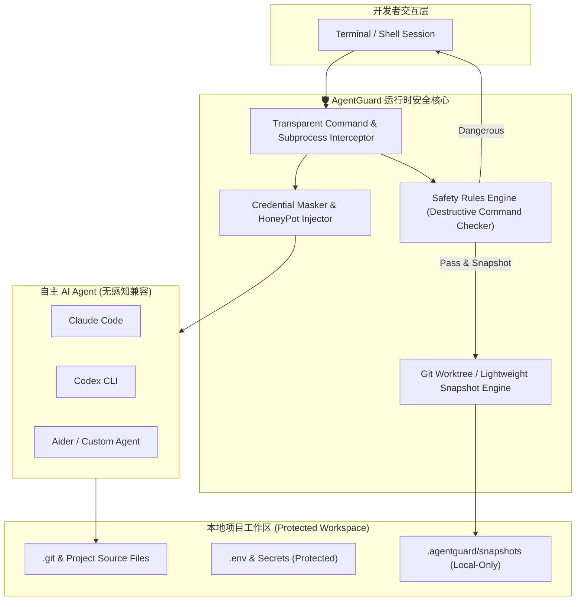

<div align="center">

# 🛡️ AgentGuard

**The Runtime Safety Enclave & Zero-Latency Rollback Engine for Autonomous AI Coding Agents**  
**面向自主 AI 编程 Agent 的轻量级运行时安全守门人与无感快照回滚中枢**

[](LICENSE)
[](https://github.com/leeeway/AgentGuard)
[](https://python.org)
[](https://github.com/leeeway/AgentGuard/pulls)

*Works seamlessly with **Claude Code**, **OpenAI Codex**, **Google Antigravity**, **Cursor CLI**, **Aider**, and custom LLM Agent runtimes.*

</div>

---

## ⚡ Why AgentGuard? / 为什么需要 AgentGuard？

随着自主 AI Agent（如 Claude Code, Codex CLI, Aider, Antigravity）具备了终端执行命令与修改文件的能力，开发者日常正面临两难的困境：

1. **“信任困境”与被打断的心流**：
   - 每次命令都手动确认？一分钟弹窗几十次，彻底失去自主 Agent 的效率优势；
   - 开启全局自动执行（Auto-approve / YOLO mode）？随时面临误删目录（`rm -rf`）、误改生产配置、覆写关键分支或执行危险 Bash 脚本的灾难。
2. **灾难发生后无法秒级自愈**：
   - 当 Agent 修改了 10 几个文件后运行测试失败并开始“胡言乱语”，传统的 `git checkout` 或 `git reset` 会连带把开发者自己未提交的代码一并冲掉。
3. **敏感凭据被 Agent 当成上下文偷运**：
   - Agent 会不假思索地读取 `.env`、`~/.aws/credentials`、`id_rsa` 或内网 token，并原样打包成 Prompt 上传至第三方大模型服务商。

**AgentGuard** 专为解决这一终极痛点而生：采用 **100% 本地化（Local-First）、零网络劫持、零侵入代理** 的运行时防御机制，在提供极速命令校验、敏感凭据拦截的同时，提供 **微秒级无感 Git 快照**。只要 Agent 乱改，敲一下 `agentguard undo` 即可一键恢复，给开发者绝对的安全感。

---

## 🚀 Key Features / 核心特性

- **⏮️ 步级无损快照与秒级撤销 (Instant Undo & Time-Travel Snapshots)**
  - Agent 在执行写入/删除或每轮任务前，自动在本地 `.agentguard/snapshots` 记录文件系统差异快照。
  - **不干扰你的正常 Git Commit 历史**：即使你本地有正在编写但未 `git commit` 的改动，AgentGuard 依然能精准仅回滚 Agent 造成的变动。
  - 支持 `agentguard undo`（撤销最后一步）、`agentguard undo --all`（撤销本轮 Agent 的全部变更）。
- **🛑 破坏性命令本地防御网 (Destructive Command Firewall)**
  - 拦截高危级命令（如未隔离的 `rm -rf`、覆盖系统关键目录、重置主分支 `git push -f`、`mkfs`、改写系统 hosts 等）。
  - 支持 **Interactive Canary（金丝雀询问）** 与 **Auto-Block（静默阻断并回传给 Agent 提示错误）**。
- **🤫 敏感信息假体注入 (Canary / Honeypot Masking)**
  - 监控并拦截 Agent 对 `.env`、`*.pem`、`~/.ssh/`、`~/.config/gcloud` 的盲目读取。
  - 支持动态注入 Mock 占位符（Fake Credential），防止开发者个人密钥泄露至公有大模型云端。
- **🔌 无侵入包装与透明代理 (Universal Transparent Wrapper)**
  - 零配置适配任何 CLI 工具：只需在命令前加 `agentguard run -- <your-agent>`，例如：
    ```bash
    agentguard run -- claude
    agentguard run -- codex
    agentguard run -- aider
    ```
- **📊 差异审计与可视化日志 (Audit & Diff Inspector)**
  - 实时记录 Agent 执行的每一条 Shell 命令、受影响的文件清单与 Diff 差异，一目了然。

---

## 🏗️ Architecture / 架构设计



---

## 📦 Quick Start / 快速开始

### 1. 安装 (Installation)

```bash
# 从源码安装开发模式
git clone https://github.com/leeeway/AgentGuard.git
cd AgentGuard
pip install -e .
```

### 2. 初始化项目防护 (Initialize)

在任意代码仓库根目录运行：

```bash
agentguard init
```
这会在当前目录生成轻量级的防护配置 `.agentguard/config.toml`。

### 3. 在受防护的环境中启动 Agent

无需更改你的 AI Agent 配置，直接通过 `agentguard run` 包装启动：

```bash
# 启动 Claude Code
agentguard run -- claude

# 或启动 Aider
agentguard run -- aider

# 或启动自定义开发脚本
agentguard run -- python agent_worker.py
```

### 4. 出现意外？一键撤回 (Instant Rollback)

当 Agent 把代码改崩了，或者执行了非预期的文件操作：

```bash
# 查看 Agent 刚才修改了哪些文件
agentguard status

# 撤销 Agent 刚才执行的这一步操作
agentguard undo

# 撤销本次 Agent 会话以来的所有改动
agentguard undo --all
```

---

## ⚙️ Configuration / 配置说明 (`.agentguard/config.toml`)

```toml
[safety]
# 拦截级别: "block" (直接拒绝), "ask" (提示确认), "warn" (仅报警记录)
dangerous_commands = "ask"

# 高危命令拦截黑名单规则 (支持正则)
blocked_patterns = [
    "^rm\\s+(-[a-zA-Z]*r[a-zA-Z]*f|--recursive\\s+--force)",
    "^git\\s+push\\s+.*(-f|--force)",
    "^git\\s+reset\\s+--hard",
    ">\\s*/etc/",
    "mkfs",
    "dd\\s+if="
]

[privacy]
# 保护以下敏感路径，禁止 Agent 直接上传或读取
protected_files = [
    ".env*",
    "**/*.pem",
    "**/*.key",
    "~/.ssh/*"
]
# 当 Agent 读取被保护文件时：block (拒绝) | mask (注入占位虚构变量)
mask_mode = "mask"

[snapshots]
# 自动在危险变更前创建快照
auto_snapshot = true
# 保留最近快照数量
max_history = 30
```

---

## 🔒 Security Principles / 安全设计哲学

1. **100% Local-First & 零外网通信**：AgentGuard 没有任何云端服务，不收集任何日志或 Telemetry，纯本地运行。
2. **零网络劫持 / 零 CA 证书侵入**：区别于传统网络代理抓包工具，AgentGuard 采用系统底层进程包装与只读文件快照，绝不碰 TLS / CA 根证书，杜绝中间人泄露风险。
3. **非破坏性快照存储**：所有快照数据独立存储在 `.agentguard/` 本地目录，严禁影响开发者原有的正常 Git 提交历史与分支树。

---

## 🗺️ Roadmap / 路线图

- [x] CLI 骨架与核心规则拦截引擎
- [x] 微秒级轻量差异快照与 `agentguard undo` 回滚
- [ ] 针对 Python/Node.js 生态的 Subprocess 动态 Hook 注入器
- [ ] macOS 顶部状态栏轻量监控指示灯（显示当前 Agent 危险等级）
- [ ] 集成 VS Code / Cursor 侧边栏一键 Undo 插件

---

## 📄 License

This project is licensed under the [MIT License](LICENSE).
