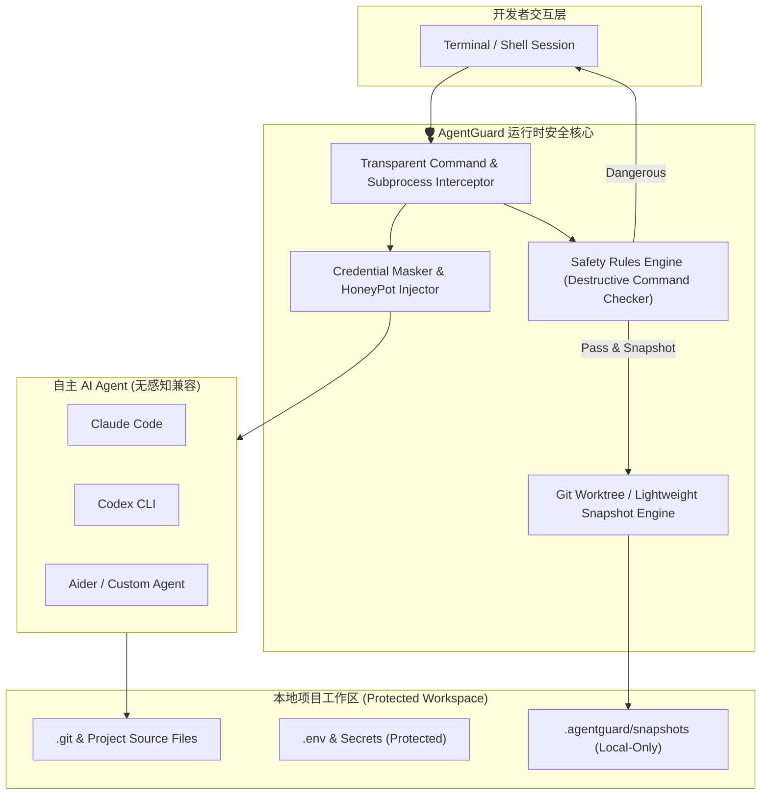

<div align="center">

# 🛡️ AgentGuard

**The Runtime Safety Enclave & Zero-Latency Rollback Engine for Autonomous AI Coding Agents**  
**面向自主 AI 编程 Agent 的轻量级运行时安全守门人与无感快照回滚中枢**

[](LICENSE)
[](https://github.com/leeeway/AgentGuard)
[](https://python.org)
[](https://github.com/leeeway/AgentGuard/pulls)

*Works seamlessly with **Claude Code**, **OpenAI Codex**, **Google Antigravity**, **Cursor CLI**, **Aider**, and custom LLM Agent runtimes.*

</div>

---

## 当前实现状态（0.1.0）

当前为本地会话回滚 MVP，下面的产品特性与架构描述是目标设计，并非全部已实现。

- `agentguard init`：创建配置，重复运行不会覆盖已有配置。
- `agentguard run -- <command>`：按配置检查**启动命令**，保存执行前后快照，实际运行程序并传递退出码。
- `agentguard status`：列出最近未撤销会话的新增、删除和修改路径。
- `agentguard history`：查看会话状态、退出码和变更路径数量，支持 `--json`。
- `agentguard diff`：查看最近一次会话的差异摘要，支持指定会话、路径和显式文本内容输出。
- `agentguard undo` / `undo --all`：当前均撤销最近一次完整会话；再次执行可撤销更早的会话。若会话结束后相关文件又被修改，会拒绝整个撤销。

**保护边界：**当前不是安全沙箱，默认不拦截子进程；可选 Python/Node.js Hook 只检查支持的进程启动事件，不拦截文件读取或网络访问，也没有凭据遮蔽功能。启动命令正则检查可以被绕过，不能用于运行不可信代码。会话期间请勿同时手动编辑工作区：快照无法区分同时发生的人为编辑和 Agent 编辑。后台进程必须在会话结束前退出。

快照以完整文件内容存放于 `.agentguard/snapshots`，记录文件权限和符号链接，不跟随符号链接。跳过所有 `.git` 和 `.agentguard` 目录项；因此不恢复 Git 元数据，也不恢复指向工作区外的文件内容。包含未跟踪、被 Git 忽略的文件及密钥文件，快照未加密，请将 `.agentguard/` 保持在 Git 忽略列表中。当前没有增量存储或微秒级性能保证，不适合大型工作区。

执行前快照失败会阻止启动；异常中断留下的不完整会话不能自动撤销。并发运行和撤销通过本地锁互斥；若进程被强制终止，仅在确认无运行会话后删除 `.agentguard/session.lock`。回滚会预检冲突，但不是文件系统原子事务，磁盘故障或同时写入仍可能造成部分恢复。

### 当前支持的配置

初始化默认使用 `dangerous_commands = "block"`，支持 `block`、`ask`、`warn`，`blocked_patterns` 为 Python 正则列表。`snapshots.max_history` 默认为 30，按会话数量保留历史。下文的 privacy 配置和 auto_snapshot 选项属于规划，当前不生效；当前始终创建会话快照。

### Python 子进程命令检查（可选）

```bash
agentguard run --python-hooks -- python agent_worker.py
```

通过 `PYTHONPATH` 注入 `sitecustomize`，安装 CPython audit hook，检查 `subprocess.Popen`、`os.system`、`os.exec`、`os.posix_spawn` 和 `os.spawn` 事件。规则沿用 `[safety]` 配置。默认继承环境的 Python 子进程也会加载 Hook；`warn` 放行并输出规则编号，`block` 拒绝，`ask` 在子进程中按拒绝处理，不读取 Agent 的 stdin。诊断不输出命令参数，以免泄露参数中的凭据。

这是协作式防误操作机制。`python -I/-E/-S`、清除环境、其他语言进程、原生扩展和未覆盖的系统调用可能绕过它；不会监控 shell 内部执行的每条命令。注入会优先加载 AgentGuard 的 `sitecustomize`，现有同名启动模块不会自动串联，依赖此模块的环境请勿启用。Node.js 使用下述独立开关启用。

### Node.js 子进程命令检查（可选）

```bash
agentguard run --node-hooks -- node agent_worker.js
# 同时启用两个运行时，适合跨语言子进程
agentguard run --python-hooks --node-hooks -- node agent_worker.js
```

通过 `NODE_OPTIONS=--require=...` 加载 Hook，保留已有的 `NODE_OPTIONS`。检查 `child_process` 的 `spawn`、`spawnSync`、`exec`、`execSync`、`execFile`、`execFileSync` 和 `fork`，支持 CommonJS、ESM 和 `util.promisify(exec/execFile)`。继承环境的 Node.js 子进程会继续加载检查。命中规则时同步抛出带 `code = "AGENTGUARD_BLOCKED"` 的错误；Promise 包装会拒绝。`warn` 放行，`ask` 按拒绝处理。

Node.js 使用 JavaScript 正则，Python 使用 Python 正则。同一份 `blocked_patterns` 必须兼容启用的运行时；例如 Python 的 `(?i)` 不能用于 Node.js。不兼容的正则会导致 Node.js 启动失败。Hook 检查命令和参数，不检查环境变量或 shell 展开后的内容。应用可替换 Hook、清除环境或直接调用原生接口绕过检查，因此不适用于隔离不可信代码。已有的 Node.js preload 也可能改变其行为。

### 会话历史与差异审计

```bash
agentguard history                  # 最近 20 次会话，最新优先
agentguard history --json --limit 5  # 机器可读元数据
agentguard diff                      # 最近一次会话，包括已撤销会话
agentguard diff --session <完整会话ID>
agentguard diff --contents --path src/main.py
```

历史记录包括会话 ID、状态（complete / incomplete / undone）、UTC 开始与结束时间、退出码、启用的 Hook 和变更路径数量。旧快照缺少的元数据显示为空；没有成功取得进程退出状态时，退出码显示 unknown。只记录会话元数据，不保存启动命令参数。历史随 `max_history` 一同裁剪。

`diff` 比较保存的执行前后快照，不读取当前工作区内容。默认只显示新增、删除、修改路径；`--contents` 显式显示 UTF-8 文本 unified diff、权限和符号链接目标，可能包含凭据，请按需使用。二进制内容省略，终端控制字符转义。`--path` 可重复，按工作区相对路径精确匹配。不完整会话没有最终差异；`--session` 使用完整会话 ID，不支持前缀匹配。目前未实现逐条命令持久审计日志。

### 开发验证

```bash
python -m unittest discover -s tests -v
```

---

## ⚡ Why AgentGuard? / 为什么需要 AgentGuard？

随着自主 AI Agent（如 Claude Code, Codex CLI, Aider, Antigravity）具备了终端执行命令与修改文件的能力，开发者日常正面临两难的困境：

1. **“信任困境”与被打断的心流**：
   - 每次命令都手动确认？一分钟弹窗几十次，彻底失去自主 Agent 的效率优势；
   - 开启全局自动执行（Auto-approve / YOLO mode）？随时面临误删目录（`rm -rf`）、误改生产配置、覆写关键分支或执行危险 Bash 脚本的灾难。
2. **灾难发生后无法秒级自愈**：
   - 当 Agent 修改了 10 几个文件后运行测试失败并开始“胡言乱语”，传统的 `git checkout` 或 `git reset` 会连带把开发者自己未提交的代码一并冲掉。
3. **敏感凭据被 Agent 当成上下文偷运**：
   - Agent 会不假思索地读取 `.env`、`~/.aws/credentials`、`id_rsa` 或内网 token，并原样打包成 Prompt 上传至第三方大模型服务商。

**AgentGuard** 专为解决这一终极痛点而生：采用 **100% 本地化（Local-First）、零网络劫持、零侵入代理** 的运行时防御机制，在提供极速命令校验、敏感凭据拦截的同时，提供 **微秒级无感 Git 快照**。只要 Agent 乱改，敲一下 `agentguard undo` 即可一键恢复，给开发者绝对的安全感。

---

## 🚀 Key Features / 核心特性

- **⏮️ 步级无损快照与秒级撤销 (Instant Undo & Time-Travel Snapshots)**
  - Agent 在执行写入/删除或每轮任务前，自动在本地 `.agentguard/snapshots` 记录文件系统差异快照。
  - **不干扰你的正常 Git Commit 历史**：即使你本地有正在编写但未 `git commit` 的改动，AgentGuard 依然能精准仅回滚 Agent 造成的变动。
  - 支持 `agentguard undo`（撤销最后一步）、`agentguard undo --all`（撤销本轮 Agent 的全部变更）。
- **🛑 破坏性命令本地防御网 (Destructive Command Firewall)**
  - 拦截高危级命令（如未隔离的 `rm -rf`、覆盖系统关键目录、重置主分支 `git push -f`、`mkfs`、改写系统 hosts 等）。
  - 支持 **Interactive Canary（金丝雀询问）** 与 **Auto-Block（静默阻断并回传给 Agent 提示错误）**。
- **🤫 敏感信息假体注入 (Canary / Honeypot Masking)**
  - 监控并拦截 Agent 对 `.env`、`*.pem`、`~/.ssh/`、`~/.config/gcloud` 的盲目读取。
  - 支持动态注入 Mock 占位符（Fake Credential），防止开发者个人密钥泄露至公有大模型云端。
- **🔌 无侵入包装与透明代理 (Universal Transparent Wrapper)**
  - 零配置适配任何 CLI 工具：只需在命令前加 `agentguard run -- <your-agent>`，例如：
    ```bash
    agentguard run -- claude
    agentguard run -- codex
    agentguard run -- aider
    ```
- **📊 差异审计与可视化日志 (Audit & Diff Inspector)**
  - 实时记录 Agent 执行的每一条 Shell 命令、受影响的文件清单与 Diff 差异，一目了然。

---

## 🏗️ Architecture / 架构设计



---

## 📦 Quick Start / 快速开始

### 1. 安装 (Installation)

```bash
# 从源码安装开发模式
git clone https://github.com/leeeway/AgentGuard.git
cd AgentGuard
pip install -e .
```

### 2. 初始化项目防护 (Initialize)

在任意代码仓库根目录运行：

```bash
agentguard init
```
这会在当前目录生成轻量级的防护配置 `.agentguard/config.toml`。

### 3. 在受防护的环境中启动 Agent

无需更改你的 AI Agent 配置，直接通过 `agentguard run` 包装启动：

```bash
# 启动 Claude Code
agentguard run -- claude

# 或启动 Aider
agentguard run -- aider

# 或启动自定义开发脚本
agentguard run -- python agent_worker.py
```

### 4. 出现意外？一键撤回 (Instant Rollback)

当 Agent 把代码改崩了，或者执行了非预期的文件操作：

```bash
# 查看 Agent 刚才修改了哪些文件
agentguard status

# 撤销 Agent 刚才执行的这一步操作
agentguard undo

# 撤销本次 Agent 会话以来的所有改动
agentguard undo --all
```

---

## ⚙️ Configuration / 配置说明 (`.agentguard/config.toml`)

```toml
[safety]
# 拦截级别: "block" (直接拒绝), "ask" (提示确认), "warn" (仅报警记录)
dangerous_commands = "ask"

# 高危命令拦截黑名单规则 (支持正则)
blocked_patterns = [
    "^rm\\s+(-[a-zA-Z]*r[a-zA-Z]*f|--recursive\\s+--force)",
    "^git\\s+push\\s+.*(-f|--force)",
    "^git\\s+reset\\s+--hard",
    ">\\s*/etc/",
    "mkfs",
    "dd\\s+if="
]

[privacy]
# 保护以下敏感路径，禁止 Agent 直接上传或读取
protected_files = [
    ".env*",
    "**/*.pem",
    "**/*.key",
    "~/.ssh/*"
]
# 当 Agent 读取被保护文件时：block (拒绝) | mask (注入占位虚构变量)
mask_mode = "mask"

[snapshots]
# 自动在危险变更前创建快照
auto_snapshot = true
# 保留最近快照数量
max_history = 30
```

---

## 🔒 Security Principles / 安全设计哲学

1. **100% Local-First & 零外网通信**：AgentGuard 没有任何云端服务，不收集任何日志或 Telemetry，纯本地运行。
2. **零网络劫持 / 零 CA 证书侵入**：区别于传统网络代理抓包工具，AgentGuard 采用系统底层进程包装与只读文件快照，绝不碰 TLS / CA 根证书，杜绝中间人泄露风险。
3. **非破坏性快照存储**：所有快照数据独立存储在 `.agentguard/` 本地目录，严禁影响开发者原有的正常 Git 提交历史与分支树。

---

## 🗺️ Roadmap / 路线图

- [x] CLI 骨架与核心规则拦截引擎
- [x] 会话级完整快照与带冲突检查的 `agentguard undo` 回滚
- [x] 会话历史、JSON 元数据与按路径查看文本差异
- [ ] 逐条命令持久审计日志
- [ ] 增量快照、性能基准与步级回滚
- [x] 可选 Python/Node.js 子进程 Hook 注入器（协作式命令检查）
- [ ] macOS 顶部状态栏轻量监控指示灯（显示当前 Agent 危险等级）
- [ ] 集成 VS Code / Cursor 侧边栏一键 Undo 插件

---

## 📄 License

This project is licensed under the [MIT License](LICENSE).
