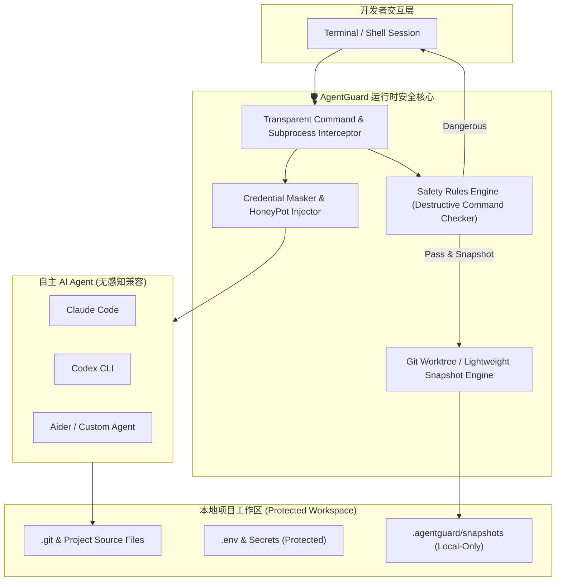

<div align="center">

# 🛡️ AgentGuard

**The Runtime Safety Enclave & Zero-Latency Rollback Engine for Autonomous AI Coding Agents**  
**面向自主 AI 编程 Agent 的轻量级运行时安全守门人与无感快照回滚中枢**

[](LICENSE)
[](https://github.com/leeeway/AgentGuard)
[](https://python.org)
[](https://github.com/leeeway/AgentGuard/pulls)

*Works seamlessly with **Claude Code**, **OpenAI Codex**, **Google Antigravity**, **Cursor CLI**, **Aider**, and custom LLM Agent runtimes.*

</div>

---

## 当前实现状态（0.1.0）

当前为本地会话回滚 MVP，下面的产品特性与架构描述是目标设计，并非全部已实现。

- `agentguard init`：创建配置，重复运行不会覆盖已有配置。
- `agentguard run -- <command>`：按配置检查**启动命令**，保存执行前后快照，实际运行程序并传递退出码。
- `agentguard status`：列出最近未撤销会话的新增、删除和修改路径。
- `agentguard history`：查看会话状态、退出码和变更路径数量，支持 `--json`。
- `agentguard diff`：查看最近一次会话的差异摘要，支持指定会话、路径和显式文本内容输出。
- `agentguard undo --dry-run`：预检快照和冲突，列出待恢复路径，不修改文件或会话状态。
- `agentguard undo` / `undo --all`：当前均撤销最近一次完整会话；再次执行可撤销更早的会话。若会话结束后相关文件又被修改，会拒绝整个撤销。

**保护边界：**当前不是安全沙箱，默认不拦截子进程；可选 Python/Node.js Hook 检查支持的进程启动事件；Python/Node.js 可另行启用受保护文件访问检查，不拦截网络访问，也没有凭据遮蔽功能。启动命令正则检查可以被绕过，不能用于运行不可信代码。会话期间请勿同时手动编辑工作区：快照无法区分同时发生的人为编辑和 Agent 编辑。后台进程必须在会话结束前退出。

新快照将文件清单存放于 `.agentguard/snapshots`，文件内容按 SHA-256 哈希去重存放于 `.agentguard/objects`；相同内容跨文件、跨会话共享一个对象。记录文件权限和符号链接，不跟随符号链接。旧版内嵌内容的快照仍可读取和撤销。跳过所有 `.git` 和 `.agentguard` 目录项；因此不恢复 Git 元数据，也不恢复指向工作区外的文件内容。包含未跟踪、被 Git 忽略的文件及密钥文件，快照未加密，请将 `.agentguard/` 保持在 Git 忽略列表中。当前实现内容去重，但每次仍扫描和读取整个工作区，变更文件保存完整内容，不是块级增量；没有微秒级性能保证，大型工作区仍需评估扫描与内存开销。

执行前快照失败会阻止启动；异常中断留下的不完整会话不能自动撤销。并发运行和撤销通过本地锁互斥；若进程被强制终止，仅在确认无运行会话后删除 `.agentguard/session.lock`。读取和回滚前会校验快照标识、路径、父目录结构、文件类型、权限与 Base64 内容；拒绝符号链接形式的快照目录和记录文件。快照临时文件会在替换前 flush/fsync。校验用于发现结构损坏，不提供签名或防篡改保证。回滚会预检冲突，但不是文件系统原子事务，磁盘故障或同时写入仍可能造成部分恢复。

### 当前支持的配置

初始化默认使用 `dangerous_commands = "block"`，支持 `block`、`ask`、`warn`，`blocked_patterns` 为 Python 正则列表。`snapshots.max_history` 默认为 30，按会话数量保留历史。`privacy.protected_files` 用于显式启用的 Python/Node.js 文件保护。下文的 mask_mode 和 auto_snapshot 选项属于规划，当前不生效；当前始终创建会话快照。

### 按文件撤销

```bash
agentguard undo --path src/main.py --dry-run
agentguard undo --path src/main.py --path tests/test_main.py
agentguard undo   # 继续撤销该会话剩余改动
```

`--path` 精确匹配工作区相对路径，可重复使用，不展开 glob；作用于最近一个尚未完全撤销的会话，不能与 `--all` 同时使用。所有选定路径在写入前一起检查，任一冲突或无效选择都会拒绝本次撤销。未选中文件上的后续编辑不会阻止本次恢复。

当前支持常规文件和符号链接的新增、修改、删除；目录本身、涉及目录的类型转换，以及需要重建缺失父目录的恢复必须使用完整 `undo`。部分恢复会记入 restored_paths，历史状态为 partially-undone，并显示 remaining_paths；`status` 隐藏已恢复路径，`diff` 仍保留完整原始差异。后续完整撤销跳过已恢复路径，因此其后的人工编辑会保留；若这些文件妨碍恢复目录结构，则仍拒绝撤销。所有剩余变更恢复后才将会话标记为 undone。

### 修改后自动验证

```bash
agentguard run --rollback-on-failure \
  --verify 'python -m unittest discover -s tests' \
  --verify 'python -m compileall -q src' \
  -- python agent_worker.py
```

`--verify` 可重复指定：主命令成功后按顺序执行，首个非零退出就停止后续验证。主命令失败则跳过所有验证。验证使用同一工作目录和启用的 Python/Node.js Hook 环境，全部目标命令在主命令启动前完成规则检查。格式错误、空命令或被阻断的验证命令会阻止整个会话启动。

验证参数按 shell 引号规则拆分，但不隐式启动 shell，不进行管道、重定向、变量或通配符展开；需要这些功能时显式使用 `sh -c '...'`。验证程序无法启动时视为退出 127。不要把不可信输入拼入验证命令。

最终退出码来自主命令或首个失败的验证命令。默认保留失败改动；配合 `--rollback-on-failure` 时，验证失败会触发整个会话回滚，包括验证产生的文件。结束快照在所有已执行验证结束后保存，因此 `diff` 记录 Agent 与验证流程的合计改动。自动恢复的限制同下文。

`history --json` 增加 `command_exit_code`（主命令退出码）和 `verification`（请求次数、已执行退出码、状态）。状态为 disabled、pending、skipped、passed 或 failed。不保存验证命令参数，验证程序自身的终端输出不做遮蔽。

### 验证超时控制

```bash
agentguard run --rollback-on-failure \
  --verify-timeout 120 \
  --verify 'python -m unittest discover -s tests' \
  -- python agent_worker.py
```

`--verify-timeout` 接受有限的正数秒数，可带小数，必须与 `--verify` 一起使用。它分别限制每项验证的执行时间，不限制主 Agent 命令、快照或回滚时间；默认不设置超时。

启用后，验证在独立会话中运行，stdin 为 EOF，stdout/stderr 沿用终端，适合非交互测试和构建。超时向验证进程组发送 SIGTERM，等待主验证进程退出（最多 1 秒），再发送 SIGKILL 清理仍在同组的后代进程，等待主验证进程回收后才记录结束快照。后续验证停止，最终退出码为 124；配合 `--rollback-on-failure` 可自动恢复改动。

历史 verification 元数据增加 `timeout_seconds` 与 `timed_out`（从 1 开始的超时验证编号）。这可区分真实超时与程序自行返回 124。自行创建新会话或进程组的后代可逃离清理范围；验证命令应等待自身子进程退出，不应启动脱离进程组的后台任务。此机制适用于 macOS/Linux。

### 执行前检查与规则解释

```bash
agentguard check -- rm -rf build
agentguard check --json -- git push --force origin main
```

`check` 使用与 `run` 相同的启动命令评估逻辑，不执行目标命令、不创建快照、不写入历史，也不会弹出确认。输出决策、配置模式、所有命中的规则编号和总规则数；编号对应 `blocked_patterns` 数组，从 1 开始。不会回显命令参数或规则内容。

退出码：0 表示 allowed 或 warning（通过 JSON 的 decision 区分）；3 表示 blocked；4 表示 confirmation-required；1 表示配置或读取错误；2 表示 CLI 用法错误。CI 可据此决定是否继续。`ask` 的检查结果不会替用户批准实际运行。

它只预测启动命令检查，不模拟 shell 展开、子进程或文件访问，allowed 不代表安全证明。空规则列表显示 rule_count=0；缺失 `blocked_patterns` 也视为空列表，不隐式恢复默认规则。配置中的 safety/snapshots 必须是 TOML 表，规则必须是字符串数组，正则必须有效，max_history 必须是正整数。配置验证失败时拒绝启动命令。

### 失败自动恢复（可选）

```bash
agentguard run --rollback-on-failure -- python agent_worker.py
# 包装“修改 + 验证”流程；任一阶段失败就撤销该会话
agentguard run --rollback-on-failure -- sh -c 'python edit.py && python -m unittest discover -s tests'
```

默认失败后保留改动，方便排查。显式启用后，命令非零退出（包括被信号终止）会在保存结束快照后恢复本次会话；成功退出则保留改动。恢复成功仍返回命令原始退出码，信号退出转换为 shell 状态（例如 SIGTERM 为 143），因此 CI 不会把失败误判为成功。恢复后的历史标记为 undone，`diff` 仍展示失败执行前后的差异。

恢复复用快照完整性与冲突检查。若冲突或 I/O 错误导致恢复失败，CLI 返回 1，并在错误信息及历史中保留原命令退出码。此时先检查工作区，再决定是否执行 `undo`；恢复不是原子事务。自动恢复只作用于已捕获的工作区文件，不恢复 Git 元数据、网络请求或外部文件。

不要在会话期间手动编辑工作区，否则这些编辑也可能被撤销。后台子进程必须随主命令结束。无法启动程序、没有完整结束快照、AgentGuard 自身被强制终止或 Ctrl-C 中断包装器时，不承诺自动恢复。`history --json` 的 `automatic_rollback` 字段记录 disabled、pending、not-started、not-needed、restored 或 failed；pending 表示没有确认恢复完成，需要人工检查。

### Python 子进程命令检查（可选）

```bash
agentguard run --python-hooks -- python agent_worker.py
```

通过 `PYTHONPATH` 注入 `sitecustomize`，安装 CPython audit hook，检查 `subprocess.Popen`、`os.system`、`os.exec`、`os.posix_spawn` 和 `os.spawn` 事件。规则沿用 `[safety]` 配置。默认继承环境的 Python 子进程也会加载 Hook；`warn` 放行并输出规则编号，`block` 拒绝，`ask` 在子进程中按拒绝处理，不读取 Agent 的 stdin。诊断不输出命令参数，以免泄露参数中的凭据。

这是协作式防误操作机制。`python -I/-E/-S`、清除环境、其他语言进程、原生扩展和未覆盖的系统调用可能绕过它；不会监控 shell 内部执行的每条命令。注入会优先加载 AgentGuard 的 `sitecustomize`，现有同名启动模块不会自动串联，依赖此模块的环境请勿启用。Node.js 使用下述独立开关启用。

### Python 受保护文件打开拦截（可选）

```bash
agentguard run --python-hooks --protect-files -- python agent_worker.py
```

`--protect-files` 必须配合至少一种运行时 Hook；此处使用 `--python-hooks` 阻止命中规则的 Python 文件打开操作，包括读取、写入和读写模式。适用于触发 CPython `open` 审计事件的 `open`、`io.open`、`pathlib` 和普通 `os.open` 路径访问。命中后抛出 `PermissionError`，不读取或替换文件内容，独立于危险命令的 block/ask/warn 模式；若程序未处理异常而失败，可配合 `--rollback-on-failure` 恢复会话。

配置示例（在已有 privacy 表中修改，不要重复建表）：

```toml
[privacy]
protected_files = [
    ".env*", "**/.env*", "*.pem", "*.key",
    "~/.ssh", "~/.aws/credentials", "~/.config/gcloud"
]
```

这是缺省规则；显式配置会替换默认列表。启用保护时规则不能为空。相对 glob 针对启动时的工作区，支持 `*`、`?`、`[]`，其中 `*` 可跨路径分隔符。绝对路径及 `~/` 相对受保护 Python 进程的家目录匹配；目录命中时，其后代也受保护。规则区分大小写，不支持环境变量插值。检查命名路径和解析后的符号链接目标，切换工作目录不改变原工作区范围。继承 Hook 环境的 Python 子进程和验证命令沿用策略。

`audit` 中的 `file.open` 只记录阻断事件，rules 指向 protected_files 的 1-based 编号，而不是 blocked_patterns；不记录被访问路径或内容。`history --json` 的 file_protection 表示是否启用了此功能。正常文件打开不逐条记录，避免审计日志膨胀。

保护只在 Hook 安装后生效，不覆盖 Python 启动早期读取、预先打开的文件描述符、原生扩展直接系统调用、dir_fd 相对访问、硬链接别名、路径替换竞态或其他语言/Shell 进程，也不拦截 unlink/rename。`-I/-E/-S` 或清除环境仍可绕过。未实现凭据伪装、网络过滤或输出遮蔽。该机制依据 [CPython open 审计事件](https://docs.python.org/3/library/audit_events.html)；[Python 文档](https://docs.python.org/3/library/sys.html#sys.addaudithook) 明确将 Python 级 audit hooks 定位为可被绕过的机制。

文件打开保护与快照排除是两套独立策略：包装器仍会快照工作区中的密钥文件，内容未加密；若不希望保存，应同时配置 snapshots.exclude，但被排除文件将无法回滚。被保护规则命中的脚本或依赖也会被拒绝打开，请缩小过宽的规则。

### Node.js 子进程命令检查（可选）

```bash
agentguard run --node-hooks -- node agent_worker.js
# 同时启用两个运行时，适合跨语言子进程
agentguard run --python-hooks --node-hooks -- node agent_worker.js
```

通过 `NODE_OPTIONS=--require=...` 加载 Hook，保留已有的 `NODE_OPTIONS`。检查 `child_process` 的 `spawn`、`spawnSync`、`exec`、`execSync`、`execFile`、`execFileSync` 和 `fork`，支持 CommonJS、ESM 和 `util.promisify(exec/execFile)`。继承环境的 Node.js 子进程会继续加载检查。命中规则时同步抛出带 `code = "AGENTGUARD_BLOCKED"` 的错误；Promise 包装会拒绝。`warn` 放行，`ask` 按拒绝处理。

Node.js 使用 JavaScript 正则，Python 使用 Python 正则。同一份 `blocked_patterns` 必须兼容启用的运行时；例如 Python 的 `(?i)` 不能用于 Node.js。不兼容的正则会导致 Node.js 启动失败。Hook 检查命令和参数，不检查环境变量或 shell 展开后的内容。应用可替换 Hook、清除环境或直接调用原生接口绕过检查，因此不适用于隔离不可信代码。已有的 Node.js preload 也可能改变其行为。

### Node.js 受保护文件访问检查（可选）

```bash
agentguard run --node-hooks --protect-files -- node agent_worker.js
# Python 与 Node.js 相互启动时，分别启用两种 Hook
agentguard run --python-hooks --node-hooks --protect-files -- node agent_worker.js
```

沿用 `privacy.protected_files`，与 Python 一样默认关闭、命中即拒绝，不受 dangerous_commands 的 warn/ask 模式影响。glob 从同一份配置转换，支持 `*`、`?`、`[]`，包括否定字符集和 Unicode；`~/` 在受保护 Node.js 进程中展开。相对路径以会话工作区为范围，切换目录后仍生效；检查符号链接目标，并为尚不存在的文件解析已有父目录。

覆盖 [Node.js fs API](https://nodejs.org/api/fs.html) 中以下路径接口：

- 同步：openSync、readFileSync、writeFileSync、appendFileSync。
- 回调：open、readFile、writeFile、appendFile；拒绝通过异步回调返回，不同步抛出策略错误（未传回调时除外），支持 util.promisify。
- Promise：fs.promises / node:fs/promises 的 open、readFile、writeFile、appendFile；拒绝时 Promise reject。
- 流：createReadStream、createWriteStream；受保护路径在创建流之前**同步抛错**，调用方需 try/catch。

支持字符串、UTF-8 Buffer 和 file URL 路径。策略错误 code 为 AGENTGUARD_PROTECTED_FILE，不含文件路径或内容。正常路径沿用原接口返回值。通过 [syncBuiltinESMExports](https://nodejs.org/api/module.html#modulesyncbuiltinesmexports) 同步 ESM 绑定。审计中的 fs.* 事件仅记录阻断，规则编号对应 protected_files，source 为 node；后续 Python/Node.js 子进程及验证命令在继承环境时继续应用各自的 Hook。

这是可被绕过的应用层检查，不覆盖模块加载器内部读取、openAsBlob、copyFile/cp、unlink/rename、预先打开的 fd/FileHandle、直接 new ReadStream/WriteStream、原生扩展、Shell 或清除 Hook 环境的进程。硬链接、大小写别名和检查后替换路径也不能提供系统级隔离。快照仍独立保存文件内容；保护规则不等于快照排除或凭据遮蔽。

### 会话历史与差异审计

```bash
agentguard history                  # 最近 20 次会话，最新优先
agentguard history --json --limit 5  # 机器可读元数据
agentguard diff                      # 最近一次会话，包括已撤销会话
agentguard diff --session <完整会话ID>
agentguard diff --contents --path src/main.py
```

历史记录包括会话 ID、状态（complete / incomplete / partially-undone / undone）、UTC 开始与结束时间、退出码、启用的 Hook 和变更路径数量。旧快照缺少的元数据显示为空；没有成功取得进程退出状态时，退出码显示 unknown。只记录会话元数据，不保存启动命令参数。历史随 `max_history` 一同裁剪。

`diff` 比较保存的执行前后快照，不读取当前工作区内容。默认只显示新增、删除、修改路径；`--contents` 显式显示 UTF-8 文本 unified diff、权限和符号链接目标，可能包含凭据，请按需使用。二进制内容省略，终端控制字符转义。`--path` 可重复，按工作区相对路径精确匹配。不完整会话没有最终差异；`--session` 使用完整会话 ID，不支持前缀匹配。运行时决策日志见下文“会话决策审计”，不覆盖 shell 内部每条命令。

### 快照排除规则

在现有 `[snapshots]` 配置表中添加：

```toml
exclude = ["node_modules", "dist", "**/node_modules", "*.log"]
```

使用工作区相对路径、正斜杠和区分大小写的 glob 匹配。采用 Python `fnmatchcase` 语义：`*` 可以匹配路径分隔符，`**` 没有独立的 Git ignore 语义；例如 `*.log` 匹配任意层级的日志文件。根目录的 node_modules 用 `node_modules`，嵌套目录用 `**/node_modules`。目录本身匹配时，整个子树不再扫描；末尾不要加 `/`。不支持否定规则，不自动使用 `.gitignore`。

排除的文件不读取内容、不进入差异审计、不计入容量预算，也无法通过普通或自动回滚恢复。不要排除需要保护的源码。`snapshot-plan --json` 显示生效的 exclude，`history --json` 的 snapshot_excludes 记录会话范围。执行结束快照与撤销沿用会话开始时的规则，不受后来配置变化影响；没有该字段的旧会话按原来的完整范围恢复。

如果 Agent 创建的目录内存在被排除或其他未记录的内容，撤销删除该目录会在预检阶段报冲突，避免部分恢复或误删。排除规则属于快照范围控制，不阻止 Agent 读取或修改对应路径。

### 快照容量预检与预算

```bash
agentguard snapshot-plan
agentguard snapshot-plan --json
```

只扫描文件元数据，统计常规文件、目录、符号链接、文件总字节数和最大文件；不读取文件内容，不创建快照。与实际快照一致，跳过 `.git` / `.agentguard`，不跟随符号链接。退出码 0 表示当前清单未发现超限或不支持的文件类型，3 表示发现问题。它不是读取权限验证，也不保证后续文件不发生变化。

可在已有配置的 `[snapshots]` 表中添加（单位为字节）：

```toml
max_file_bytes = 52428800    # 单文件 50 MiB
max_total_bytes = 524288000 # 单次完整清单 500 MiB
```

两项均为可选正整数，未设置即不限制，旧配置行为不变。总量按所有文件的逻辑大小累计，去重文件也计入；不是磁盘占用或 Python 内存上限。实际读取采用有界读取并再次检查长度，以发现扫描后增长的文件。

执行前超限会阻止命令启动。执行后超限会报错并留下不完整会话，保留执行前快照和当前工作区；无法执行自动恢复或普通 undo，因为缺少完整结束快照。请为构建输出预留预算。已保存会话的撤销不套用后来设置的预算，以免阻断已有恢复数据。

### 快照空间回收

```bash
agentguard gc --dry-run   # 预览无引用对象数量与可释放字节数
agentguard gc             # 删除无引用内容对象
```

`snapshots.max_history` 裁剪会话清单后，内容对象保留至显式执行 `gc`。垃圾回收与运行、撤销共用工作区锁，先读取并校验所有保留会话，再删除不被引用的对象。已撤销会话仍可用于差异审计，因此它们引用的内容会保留。存在损坏清单、丢失对象或哈希不匹配时停止清理，不自动修复或丢弃历史。

新格式为 version 2，内容对象读入时验证 SHA-256；这是损坏检测，不是防篡改签名。旧版 AgentGuard 无法读取新格式，请勿降级后操作新会话。旧格式不会批量迁移；再次保存旧会话（例如撤销）时会转换为新格式。对象未加密，仍需保护 `.agentguard/` 的访问权限。

### 会话决策审计

```bash
agentguard audit                      # 最新保留会话的最后 100 个事件
agentguard audit --json --limit 20
agentguard audit --session <完整会话ID>
```

新会话在 `.agentguard/audit/<会话ID>.jsonl` 记录启动检查、实际执行的验证启动，以及启用 Python/Node.js Hook 时的子进程检查事件；启用文件保护后还记录 Python/Node.js 受保护文件访问的阻断事件。每行包含 UTC 时间、PID、来源、事件名、决策和规则编号，不接受或保存命令参数、规则文本、文件内容。CLI 记录所有命中规则，运行时 Hook 记录首个命中规则；无命中记录 allowed。ask 经用户批准的 CLI 启动记录 confirmed，子进程 ask 仍按 blocked 处理。

`audit` 按追加顺序输出最后 N 个事件，`--json` 返回数组。旧会话没有日志时返回空数组。可通过完整 ID 查询已被 max_history 裁剪的会话日志；审计日志单独保留，当前不会被 gc 或会话裁剪删除。文本输出转义终端控制字符。日志文件初始权限为 0600，拒绝符号链接日志路径；日志写入失败会阻止对应的受检查启动，不静默丢弃事件。

这是协作式决策记录，不是不可篡改日志；应用可以清除环境或绕过 Hook，日志也可能在崩溃时损坏，读取时会报告问题。它记录检查结果，不代表命令已经执行成功，不覆盖 shell 内部的每条命令。新会话启动前被规则拒绝或用户取消的操作尚不保存为会话日志。Node.js 内部调用可能产生多条事件。文件内容、程序终端输出和其他未启用 Hook 的进程不在审计范围内。

### 工作区故障诊断

```bash
agentguard doctor
agentguard doctor --json
```

集中检查配置、空规则集、工作区锁、快照存储路径、每个会话清单及其引用内容的哈希完整性，并提示不完整会话和未确认完成的自动恢复。某个快照损坏不会阻止检查其他快照。JSON 输出包含稳定的问题 code、级别、会话标识和建议处理动作，便于 CI 或外部界面集成。

退出码 0 表示检查通过，1 表示存在错误，3 表示仅有警告。诊断不写文件、不删除锁、不自动恢复、不输出文件内容；哈希验证需要读取已保存的内容对象。只验证保留会话引用的对象，不检查所有孤立对象。锁存在时无法区分正在运行或异常遗留，报告会提醒先确认会话状态；运行中的工作区可能在检查期间变化。通过诊断不代表子进程防护已启用，也不是安全隔离证明。

### 开发验证

```bash
python -m unittest discover -s tests -v
```

---

## ⚡ Why AgentGuard? / 为什么需要 AgentGuard？

随着自主 AI Agent（如 Claude Code, Codex CLI, Aider, Antigravity）具备了终端执行命令与修改文件的能力，开发者日常正面临两难的困境：

1. **“信任困境”与被打断的心流**：
   - 每次命令都手动确认？一分钟弹窗几十次，彻底失去自主 Agent 的效率优势；
   - 开启全局自动执行（Auto-approve / YOLO mode）？随时面临误删目录（`rm -rf`）、误改生产配置、覆写关键分支或执行危险 Bash 脚本的灾难。
2. **灾难发生后无法秒级自愈**：
   - 当 Agent 修改了 10 几个文件后运行测试失败并开始“胡言乱语”，传统的 `git checkout` 或 `git reset` 会连带把开发者自己未提交的代码一并冲掉。
3. **敏感凭据被 Agent 当成上下文偷运**：
   - Agent 会不假思索地读取 `.env`、`~/.aws/credentials`、`id_rsa` 或内网 token，并原样打包成 Prompt 上传至第三方大模型服务商。

**AgentGuard** 专为解决这一终极痛点而生：采用 **100% 本地化（Local-First）、零网络劫持、零侵入代理** 的运行时防御机制，在提供极速命令校验、敏感凭据拦截的同时，提供 **微秒级无感 Git 快照**。只要 Agent 乱改，敲一下 `agentguard undo` 即可一键恢复，给开发者绝对的安全感。

---

## 🚀 Key Features / 核心特性

- **⏮️ 步级无损快照与秒级撤销 (Instant Undo & Time-Travel Snapshots)**
  - Agent 在执行写入/删除或每轮任务前，自动在本地 `.agentguard/snapshots` 记录文件系统差异快照。
  - **不干扰你的正常 Git Commit 历史**：即使你本地有正在编写但未 `git commit` 的改动，AgentGuard 依然能精准仅回滚 Agent 造成的变动。
  - 支持 `agentguard undo`（撤销最后一步）、`agentguard undo --all`（撤销本轮 Agent 的全部变更）。
- **🛑 破坏性命令本地防御网 (Destructive Command Firewall)**
  - 拦截高危级命令（如未隔离的 `rm -rf`、覆盖系统关键目录、重置主分支 `git push -f`、`mkfs`、改写系统 hosts 等）。
  - 支持 **Interactive Canary（金丝雀询问）** 与 **Auto-Block（静默阻断并回传给 Agent 提示错误）**。
- **🤫 敏感信息假体注入 (Canary / Honeypot Masking)**
  - 监控并拦截 Agent 对 `.env`、`*.pem`、`~/.ssh/`、`~/.config/gcloud` 的盲目读取。
  - 支持动态注入 Mock 占位符（Fake Credential），防止开发者个人密钥泄露至公有大模型云端。
- **🔌 无侵入包装与透明代理 (Universal Transparent Wrapper)**
  - 零配置适配任何 CLI 工具：只需在命令前加 `agentguard run -- <your-agent>`，例如：
    ```bash
    agentguard run -- claude
    agentguard run -- codex
    agentguard run -- aider
    ```
- **📊 差异审计与可视化日志 (Audit & Diff Inspector)**
  - 实时记录 Agent 执行的每一条 Shell 命令、受影响的文件清单与 Diff 差异，一目了然。

---

## 🏗️ Architecture / 架构设计



---

## 📦 Quick Start / 快速开始

### 1. 安装 (Installation)

```bash
# 从源码安装开发模式
git clone https://github.com/leeeway/AgentGuard.git
cd AgentGuard
pip install -e .
```

### 2. 初始化项目防护 (Initialize)

在任意代码仓库根目录运行：

```bash
agentguard init
```
这会在当前目录生成轻量级的防护配置 `.agentguard/config.toml`。

### 3. 在受防护的环境中启动 Agent

无需更改你的 AI Agent 配置，直接通过 `agentguard run` 包装启动：

```bash
# 启动 Claude Code
agentguard run -- claude

# 或启动 Aider
agentguard run -- aider

# 或启动自定义开发脚本
agentguard run -- python agent_worker.py
```

### 4. 出现意外？一键撤回 (Instant Rollback)

当 Agent 把代码改崩了，或者执行了非预期的文件操作：

```bash
# 查看 Agent 刚才修改了哪些文件
agentguard status

# 先预览恢复路径并检查冲突
agentguard undo --dry-run

# 撤销最近一次完整会话
agentguard undo

# 撤销本次 Agent 会话以来的所有改动
agentguard undo --all
```

---

## ⚙️ Configuration / 配置说明 (`.agentguard/config.toml`)

```toml
[safety]
# 拦截级别: "block" (直接拒绝), "ask" (提示确认), "warn" (仅报警记录)
dangerous_commands = "ask"

# 高危命令拦截黑名单规则 (支持正则)
blocked_patterns = [
    "^rm\\s+(-[a-zA-Z]*r[a-zA-Z]*f|--recursive\\s+--force)",
    "^git\\s+push\\s+.*(-f|--force)",
    "^git\\s+reset\\s+--hard",
    ">\\s*/etc/",
    "mkfs",
    "dd\\s+if="
]

[privacy]
# 保护以下敏感路径，禁止 Agent 直接上传或读取
protected_files = [
    ".env*",
    "**/*.pem",
    "**/*.key",
    "~/.ssh/*"
]
# 当 Agent 读取被保护文件时：block (拒绝) | mask (注入占位虚构变量)
mask_mode = "mask"

[snapshots]
# 自动在危险变更前创建快照
auto_snapshot = true
# 保留最近快照数量
max_history = 30
```

---

## 🔒 Security Principles / 安全设计哲学

1. **100% Local-First & 零外网通信**：AgentGuard 没有任何云端服务，不收集任何日志或 Telemetry，纯本地运行。
2. **零网络劫持 / 零 CA 证书侵入**：区别于传统网络代理抓包工具，AgentGuard 采用系统底层进程包装与只读文件快照，绝不碰 TLS / CA 根证书，杜绝中间人泄露风险。
3. **非破坏性快照存储**：所有快照数据独立存储在 `.agentguard/` 本地目录，严禁影响开发者原有的正常 Git 提交历史与分支树。

---

## 🗺️ Roadmap / 路线图

- [x] CLI 骨架与核心规则拦截引擎
- [x] 执行前规则解释、JSON 决策输出与配置类型校验
- [x] 会话级完整快照与带冲突检查的 `agentguard undo` 回滚
- [x] 回滚预览、快照结构校验和只读目录恢复
- [x] 按文件/符号链接撤销、部分恢复状态与剩余变更跟踪
- [x] 可选失败自动恢复，保留退出码与失败差异审计
- [x] 顺序验证命令、失败停止及验证失败自动恢复
- [x] 验证超时、进程组清理和超时审计
- [x] 会话历史、JSON 元数据与按路径查看文本差异
- [x] 会话决策审计日志、Python/Node.js Hook 事件与 JSON 查询
- [ ] 审计日志保留策略与更广泛进程事件覆盖
- [x] 内容寻址去重存储、旧快照兼容与垃圾回收预览
- [x] 快照容量预检、单文件及总量预算
- [x] 快照排除规则、会话范围保存及撤销冲突保护
- [x] 只读健康诊断、多快照完整性报告和处理建议
- [ ] 增量扫描、块级增量、性能基准与步级回滚
- [x] 可选 Python/Node.js 子进程 Hook 注入器（协作式命令检查）
- [x] Python 受保护文件打开拦截、自定义路径规则和无内容审计
- [x] Node.js 常用 fs 接口防护、异步/ESM 兼容与审计
- [ ] 凭据遮蔽与更广泛文件操作覆盖
- [ ] macOS 顶部状态栏轻量监控指示灯（显示当前 Agent 危险等级）
- [ ] 集成 VS Code / Cursor 侧边栏一键 Undo 插件

---

## 📄 License

This project is licensed under the [MIT License](LICENSE).
